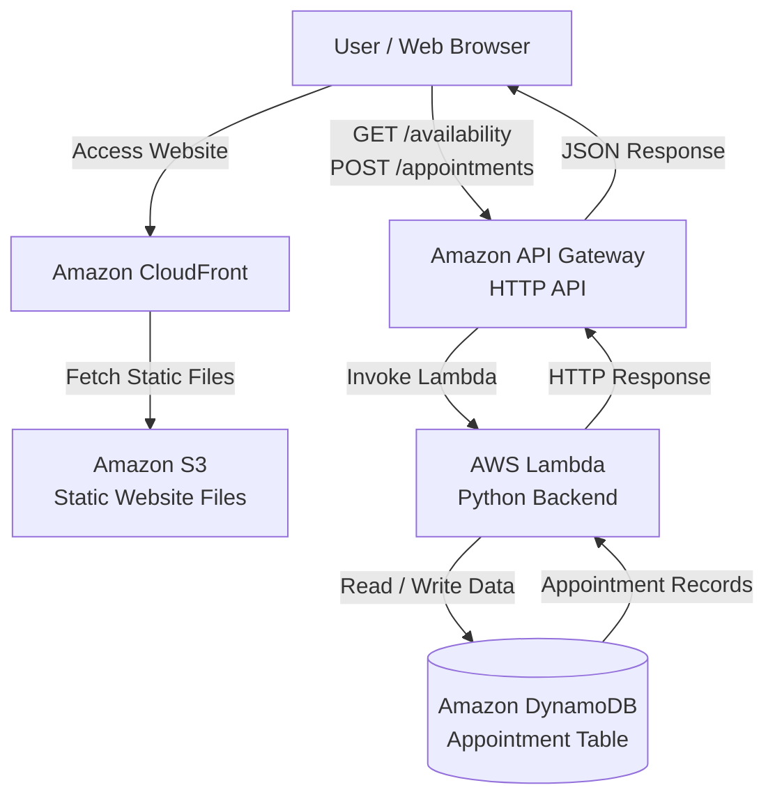

# AWS-Book-Appointment
## Overview
Book Appointment is a serverless web application that allows users to check appointment availability and book appointments through a simple and user-friendly interface.

The application uses AWS services to handle appointment requests, process business logic, and store appointment details without managing traditional servers.

Users can select an appointment date, view available time slots, enter their details, and submit a booking. The backend validates the request, checks existing appointments, and stores confirmed bookings in Amazon DynamoDB.

---
## Live Demo : [AWS-Book-Appointment](https://d3g2wddbbs0bqk.cloudfront.net)
---

## Features

- **Appointment Availability:** View available appointment slots for a selected date.
- **Appointment Booking:** Book an appointment by providing customer name, date, and time.
- **One-Hour Time Slots:** Offers predefined one-hour appointment slots.
- **Weekday Scheduling:** Supports Monday through Friday appointments.
- **Lunch Break:** Excludes the 12:00 PM – 1:00 PM lunch period.
- **Input Validation:** Validates required fields, appointment dates, and time slots.
- **Duplicate Booking Check:** Checks existing appointments and prevents booking an already-occupied time slot.
- **REST API Integration:** Uses API Gateway HTTP endpoints to communicate between the frontend and backend.
- **Serverless Backend:** Processes booking requests using AWS Lambda and Python.
- **Appointment Storage:** Stores appointment details in Amazon DynamoDB.
- **HTTP Error Handling:** Returns appropriate status codes, including 400 (Bad Request), 404 (Not Found), 409 (Conflict), and 500 (Internal Server Error).
---

## Architecture Diagram

## API Endpoints
## API Endpoints

| HTTP Method | Endpoint | Parameters | Description | Success Status |
|---|---|---|---|---|
| GET | `/availability` | `appointmentDate` (query parameter) | Retrieves available appointment slots for the selected date. | 200 OK |
| POST | `/appointments` | `customerName`, `appointmentDate`, `appointmentTime` (JSON body) | Validates and books an appointment, then stores the details in DynamoDB. | 201 Created |

### HTTP Status Codes

| Status Code | Description |
|---|---|
| 200 | Availability retrieved successfully |
| 201 | Appointment created successfully |
| 400 | Missing or invalid input |
| 404 | Requested route not found |
| 409 | Appointment slot already booked |
| 500 | Internal server error |
