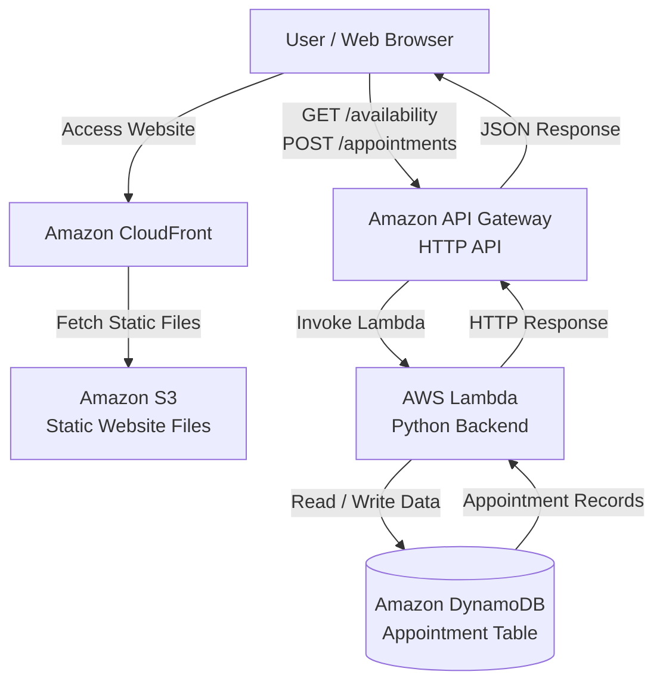
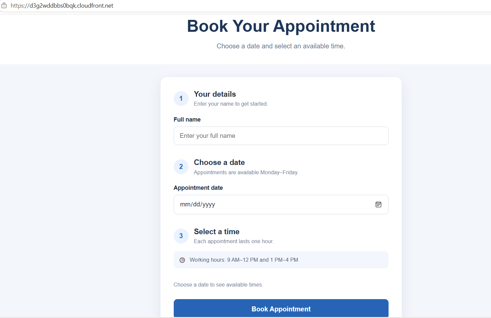
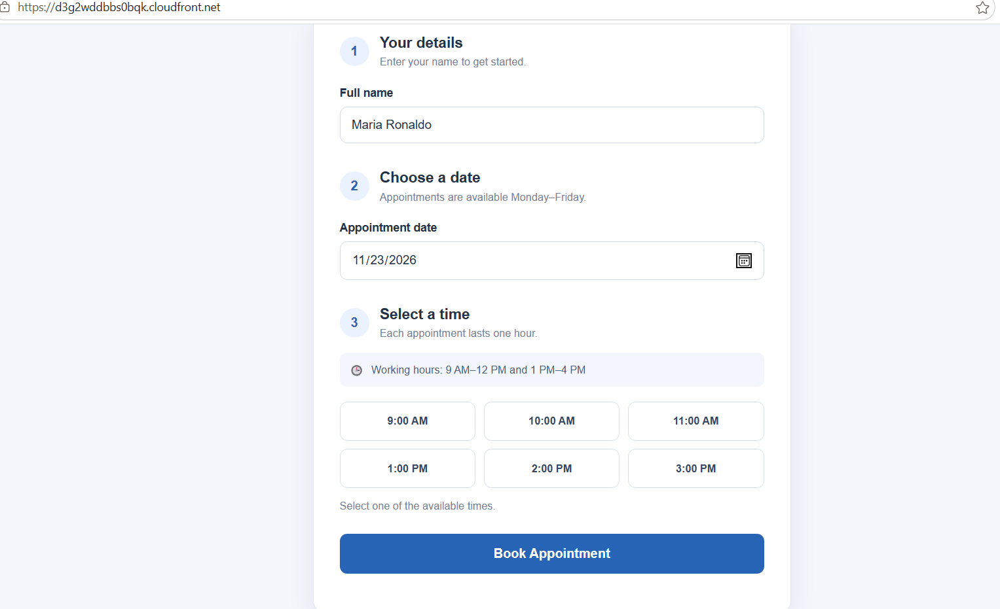
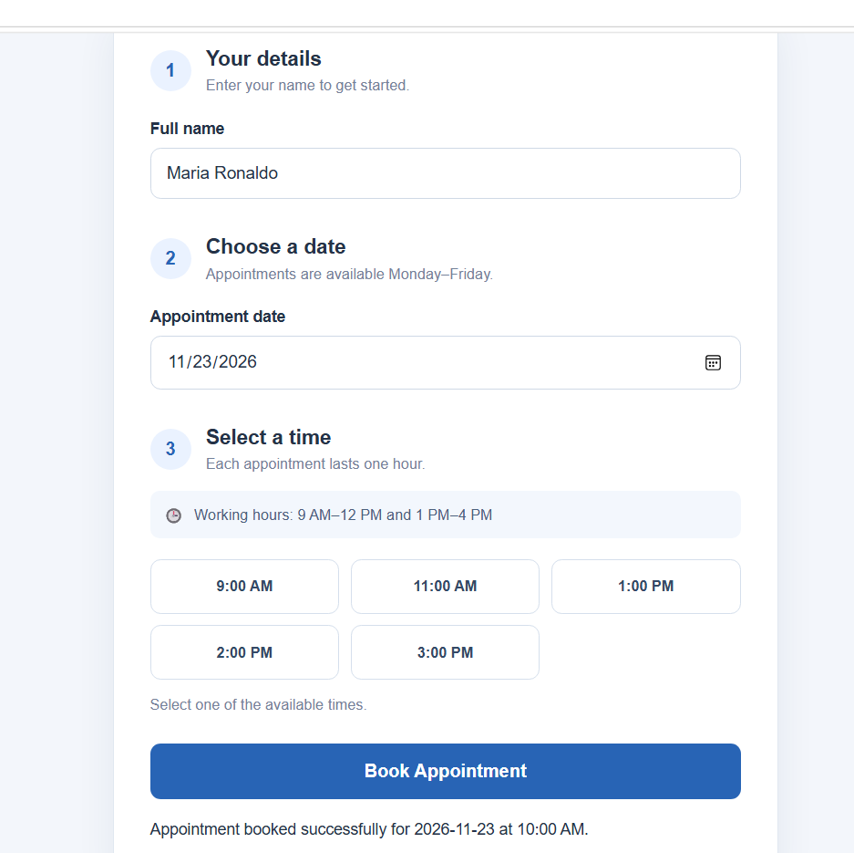
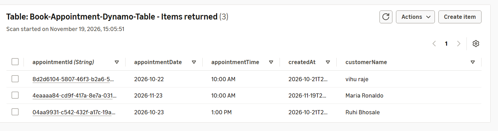
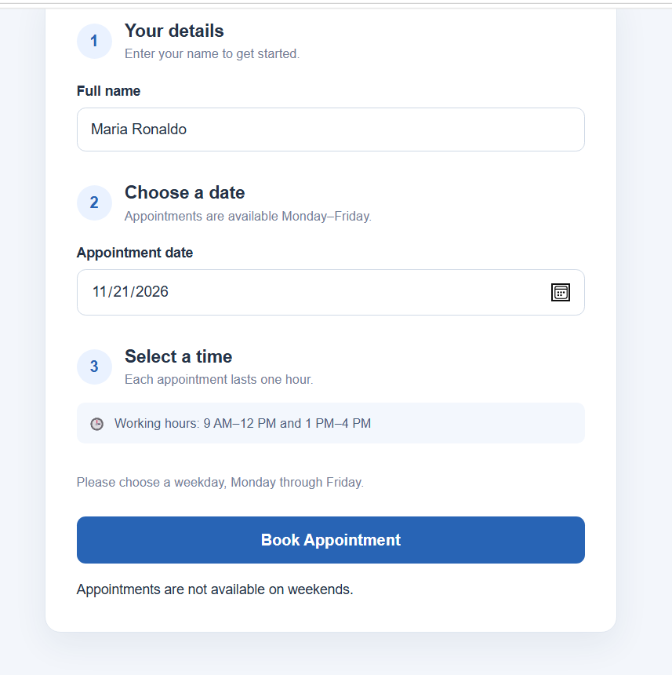

# AWS-Book-Appointment
## Overview
Book Appointment is a serverless web application that allows users to check appointment availability and book appointments through a simple and user-friendly interface.

The application uses AWS services to handle appointment requests, process business logic, and store appointment details without managing traditional servers.

Users can select an appointment date, view available time slots, enter their details, and submit a booking. The backend validates the request, checks existing appointments, and stores confirmed bookings in Amazon DynamoDB.

---
## Live Demo : [AWS-Book-Appointment](https://d3g2wddbbs0bqk.cloudfront.net)

## Features

- **Appointment Availability:** View available appointment slots for a selected date.
- **Appointment Booking:** Book an appointment by providing customer name, date, and time.
- **One-Hour Time Slots:** Offers predefined one-hour appointment slots.
- **Weekday Scheduling:** Supports Monday through Friday appointments.
- **Lunch Break:** Excludes the 12:00 PM – 1:00 PM lunch period.
- **Input Validation:** Validates required fields, appointment dates, and time slots.
- **Duplicate Booking Check:** Checks existing appointments and prevents booking an already-occupied time slot.
- **HTTP API Integration:** Uses API Gateway HTTP endpoints to communicate between the frontend and backend.
- **Serverless Backend:** Processes booking requests using AWS Lambda and Python.
- **Appointment Storage:** Stores appointment details in Amazon DynamoDB.
- **HTTP Error Handling:** Returns appropriate status codes, including 400 (Bad Request), 404 (Not Found), 409 (Conflict), and 500 (Internal Server Error).
---

## Architecture Diagram


## API Endpoints

| HTTP Method | Endpoint | Parameters | Description | Success Status |
|---|---|---|---|---|
| GET | `/availability` | `appointmentDate` (query parameter) | Retrieves available appointment slots for the selected date. | 200 OK |
| POST | `/appointments` | `customerName`, `appointmentDate`, `appointmentTime` (JSON body) | Validates and books an appointment, then stores the details in DynamoDB. | 201 Created |

### HTTP Status Codes

| Status Code | Description |
|---|---|
| 200 | Availability retrieved successfully |
| 201 | Appointment created successfully |
| 400 | Missing or invalid input |
| 404 | Requested route not found |
| 409 | Appointment slot already booked |
| 500 | Internal server error |

## DynamoDB Table Design

**Table Name:** `Book-Appointment-Dynamo-Table`


**Primary Key:** `appointmentId` (String)

| Attribute | Data Type | Key Type | Description |
|---|---|---|---|
| `appointmentId` | String | Partition Key (PK) | Unique identifier for each appointment |
| `customerName` | String | Regular Attribute | Name of the customer |
| `appointmentDate` | String | Regular Attribute | Selected appointment date (`YYYY-MM-DD`) |
| `appointmentTime` | String | Regular Attribute | Selected appointment time |
| `createdAt` | String | Regular Attribute | Timestamp indicating when the appointment was created |

### Sample DynamoDB Item

```json
{
  "appointmentId": "unique-appointment-id",
  "customerName": "John",
  "appointmentDate": "2026-11-20",
  "appointmentTime": "10:00 AM",
  "createdAt": "2026-11-18T15:30:00+00:00"
}
```
## Implementation Steps
**Step 1:** 

Created an S3 bucket to store the frontend HTML, CSS, and JavaScript files. 

**Step 2:** 

Created the Book-Appointment-Dynamo-Table. 

Configured appointmentId as the partition key. 

**Step 3:** 

Created BookAppointment-Lambda-Role. 

Configured the required permissions for Lambda to access DynamoDB. 

**Step 4:** 

Created the Book-Appointment-Lambda function using Python. 

Implemented appointment availability retrieval and booking logic. 

Added input validation and error handling. 

**Step 5:** 

Created an HTTP API in API Gateway. 

Configured the GET /availability and POST /appointments routes. 

Integrated both routes with the Lambda function. 

Configured CORS for frontend communication. 

**Step 6:** 

Uploaded the HTML, CSS, and JavaScript files to Amazon S3. 

Configured Amazon CloudFront to distribute the frontend content.  

**Step 7:** 

Connected the frontend JavaScript to API Gateway endpoints. 

Implemented availability retrieval and appointment booking requests. 

**Step 8:** 

Tested appointment availability retrieval. 

Tested successful appointment booking. 

Verified that already-booked slots are rejected. 
``
## Screenshots

### Website Homepage



### Retrieve Available SLots For Given Date



### Booking Appointment Scuccessful

 

### DynamoDB Table After Saving Appointment




### Weekend Booking




---

## Repository Structure

```text
cloud-file-flow/
├── lambda/
│   └── Book-Appointment-lambda.py
├── screenshots/
│   └── AvailableTimeSlots.png
│   └── BookedAppointment.png
│   └── uploaded.png
│   └── WeekendBooking.png
│   └── dynamodb-table.png
│   └── homepage.png
|__ website/
│   └── index.html
│   └── script.js
│   └── style.css
├── README.md

```
## Security Best Practices

* **IAM Least Privilege:** The Lambda execution role is configured to provide access to the required AWS resources. Permissions should be limited to the specific DynamoDB table and required actions.

* **S3 Bucket Protection:** Amazon S3 Block Public Access is enabled to prevent direct public access to the frontend bucket.

* **CloudFront Origin Access Control (OAC):** CloudFront provides controlled access to the private S3 origin.

* **HTTPS Communication:** Use HTTPS for communication between the browser, CloudFront, and API Gateway.

* **Input Validation:** The Lambda function validates required appointment details, dates, and time slots before processing requests.

* **Error Handling:** The application returns appropriate HTTP status codes and avoids exposing internal error details to users.

* **DynamoDB Access Control:** Access to appointment records is managed through the Lambda execution role rather than exposing database access to the frontend.

* **Amazon CloudWatch:** Used Cloudwatch Logs to monitor Lambda execution and troubleshoot errors.

---


